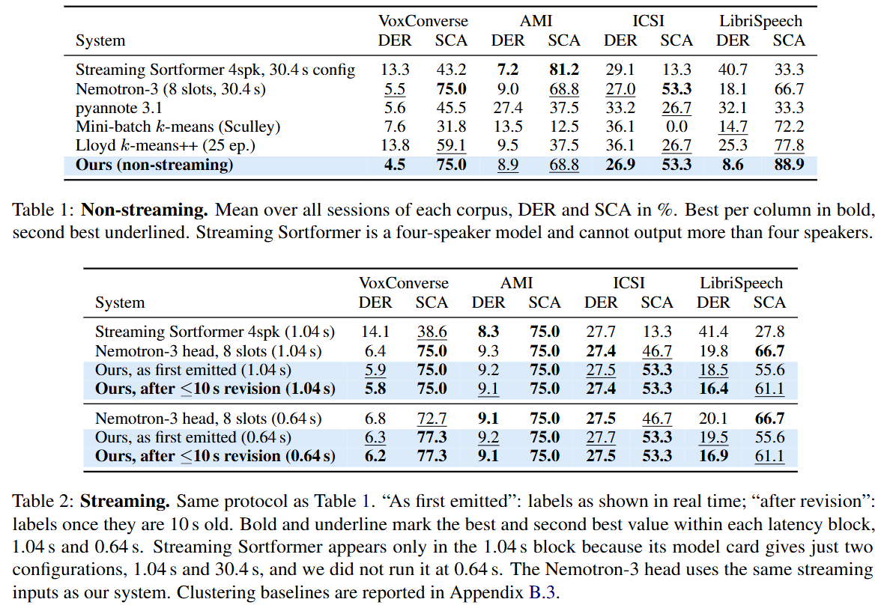

# eDIAR: training-free open-speaker streaming diarization for long meetings and large archives

**Training-free.** This repository contains code only and stores no weights. It lifts the speaker limit of a fixed-slot
diarizer ([Nemotron-3 Diarization](https://huggingface.co/nvidia/Nemotron-3-Diarization), 8 slots) by clustering speaker
embeddings (WeSpeaker ResNet34-LM) *inside a slot*, and only after every slot has been used. The clustering engine is the
official [e-means](https://github.com/facebookresearch/faiss/tree/main/contrib/e_means) algorithm.
The streaming system re-clusters a bounded 90 s window every chunk, may revise labels for 10 s, and anchors permanent
speaker ids to the slots of the head.

[Paper](https://arxiv.org/abs/2611.18529) · [Run the live microphone demo](https://github.com/KyuDan1/eDIAR#run-the-original-live-server-locally) · [Precomputed playback demo](https://kyudan1.github.io/eDIAR/)



## Live microphone demo — run on your own GPU

The live demo runs on **your own CUDA GPU machine**. Follow the
[installation and server setup guide](https://github.com/KyuDan1/eDIAR#run-the-original-live-server-locally)
to clone the GitHub repository and install the dependencies. From that repository root:

```sh
HF_HUB_OFFLINE=0 OMP_NUM_THREADS=4 OPENBLAS_NUM_THREADS=4 MKL_NUM_THREADS=4 \
  python src/live_server.py --host 127.0.0.1 --port 8123 --device cuda
```

1. Wait for **`models ready`** in the server log, then open **http://localhost:8123**.
2. Choose your microphone and keep **low (1.04 s · 권장)** selected.
3. Click **● 시작 (Start)**, allow microphone access, and speak. Speaker labels and the timeline update live.
4. Click **■ 종료 (Stop)**, then **결과 내려받기 (Download results)** to save the labels.

If the GPU is on a remote machine, run this on your laptop and open the same localhost URL:

```sh
ssh -N -L 8123:127.0.0.1:8123 user@gpu-host
```

Replace `user@gpu-host` with your server's SSH address. Direct network access requires
browser-trusted HTTPS for microphone permission; see the setup guide for certificate options.
The first server launch downloads the upstream models. One session is accepted at a time;
audio stays in memory and is not saved by the app. Labels may be revised for 10 seconds.
The 1.04 s / 0.64 s values describe the model input buffer, excluding compute and network delay.

There is no hosted live demo. The playback link above replays precomputed results.

## Run the original live server locally

Requires a CUDA GPU machine.

```sh
git clone https://github.com/KyuDan1/eDIAR.git && cd eDIAR
pip install -r requirements.txt -r requirements-live.txt
```

The server code is in `src/` (`live_server.py`, `live_pipeline.py`, `live.html`). Start it with the command in the section above.
The first launch downloads the upstream models (`HF_TOKEN` if they are gated for you; the command above sets `HF_HUB_OFFLINE=0`).
Browsers only allow microphone access on `localhost` or HTTPS. For direct network access, pass your own certificate:

```sh
python src/live_server.py --host 0.0.0.0 --port 8123 --device cuda --cert cert.pem --key key.pem
```

## Usage: streaming or non-streaming

One class, one switch. Everything else (models, clustering, speaker ids) is the same.

| | `streaming=True` (default) | `streaming=False` |
|---|---|---|
| Audio | arrives in chunks, causal | whole recording at once |
| Latency | 1.04 s (`latency="low_latency"`) or 0.64 s (`"very_low_latency"`) | none, runs after the recording |
| Labels | provisional, revised for 10 s, then fixed | final |
| Clustering | bounded 90 s window, re-run every chunk | all embeddings of the session at once |
| Use it for | live meetings, long recordings, bounded cost | files, highest accuracy |
| Paper setting | streaming tables | non-streaming tables |

```python
import soundfile as sf
from emeans_diar import SlotEMeansDiarizer

wav, sr = sf.read("meeting.wav", dtype="float32")             # mono

# 1) streaming (default): audio is fed in 100 ms chunks like a live system
dia = SlotEMeansDiarizer(device="cuda", streaming=True, latency="low_latency")
for start, end, speaker in dia.diarize(wav, sr):
    print(f"{start:7.2f} {end:7.2f} spk{speaker}")

# 2) non-streaming: the whole file at once
dia = SlotEMeansDiarizer(device="cuda", streaming=False)
segments = dia.diarize(wav, sr)

# 3) real streaming loop (live audio): incremental interface
dia = SlotEMeansDiarizer(streaming=True)
session = dia.new_session()
for pcm in microphone_chunks():                               # 16 kHz int16 bytes, any chunk size
    msgs = session.feed(pcm)                                  # provisional + revised labels
session.feed(None, flush=True)
```

Command line, RTTM on stdout:

```bash
python examples/diarize.py meeting.wav                        # streaming, 1.04 s
python examples/diarize.py meeting.wav --latency very_low_latency
python examples/diarize.py meeting.wav --offline              # non-streaming
```

The two upstream models are downloaded from their own repositories on first use (`HF_TOKEN` if they are gated for you).
Install with `pip install -r requirements.txt`.

## Results (streaming, 1.04 s input buffer, DER %, collar 0.25 s, overlap scored)

| System | VoxConverse | AMI | ICSI | LibriSpeech-OpenSpk |
|---|---|---|---|---|
| Streaming Sortformer 4spk v2.1 | 14.1 | 8.3 | 27.7 | 41.4 |
| Nemotron-3 head (8 slots) | 6.4 | 9.3 | 27.4 | 19.8 |
| **This repository** (after revision) | 5.8 | 9.1 | 27.4 | 16.4 |

Numbers are generated from the result files of the accompanying paper (cropped sessions of 7-8 minutes; 44 / 16 / 15 / 18 sessions).

What this gives you:

- **No cap on the number of speakers.** The 8-slot Nemotron-3 head becomes open-speaker without retraining; the paper shows the same for the 4-slot Streaming Sortformer.
- **Robust on long meetings.** Bounded-window re-clustering and slot-anchored ids keep the error flat over hour-long meetings.
- **Linking speakers across recordings.** Frame-level linking with e-means finds the same person across an archive of more than a thousand speakers, reaching the loss of Lloyd's k-means several times faster.
- **Low and constant compute.** The cost per update does not grow with the meeting (real-time factor about 0.09 on a shared CPU host).

## Licenses

Code: Apache-2.0 (see `LICENSE`, `NOTICE`). Vendored e-means: MIT (Meta). The models it downloads keep their own licenses
(Nemotron-3 Diarization: openmdw-1.1; WeSpeaker ResNet34-LM: see its model card).
